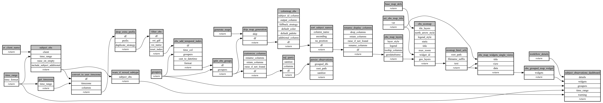

```
# AUTOGENERATED BY ECOSCOPE-WORKFLOWS; see fingerprint in README.md for details

```

```yaml
# fingerprint:
artifacts_sha256_basic: 9f2919501db08c2c58437ba8514de1140b82e8c107b9c5ab9e6b03d4da9d85dd
artifacts_sha256_strict: 6a5ef3fa9b98ac24b8e3fdf9acbfce52a9c2b1c901f24e4757a4059184d8611b
installed_requirements:
- channel: https://repo.prefix.dev/ecoscope-workflows/
  name: ecoscope-platform
  version: {version: ==2.31.0}
- channel: conda-forge
  name: pydeck
  version: {version: ==0.9.2}
params_sha256: a43e16a129ce6580851e80d13de8754e82dd73421bed5bb00f404b2c2cb5b82d
spec_sha256: 28a017e3800e6ab21ac93a994a297f6ffad48b10cfeff93f8b20bde7afe353de

```

# ecoscope-workflows-subject-observations-download-workflow



