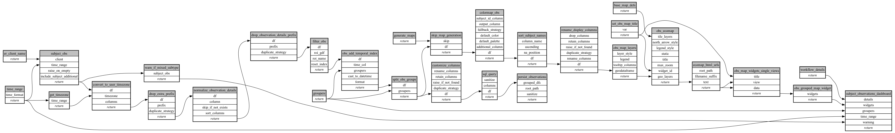

```
# AUTOGENERATED BY ECOSCOPE-WORKFLOWS; see fingerprint in README.md for details

```

```yaml
# fingerprint:
artifacts_sha256_basic: 4437869cc0a2dba899af4774c5e2fc4933b518a3bc484fe3172b974baaba9e62
artifacts_sha256_strict: 5b40f2cf2122cd1c5f7a7409be70cf1571003e7344c3064cf77d7093d44dce26
installed_requirements:
- channel: https://repo.prefix.dev/ecoscope-workflows/
  name: ecoscope-platform
  version: {version: ==2.27.1}
- channel: conda-forge
  name: pydeck
  version: {version: ==0.9.2}
params_sha256: dfb0f3460b3112eb0118c5cddf9097cc0f83c6e9bf305a80d8752e9a974620e5
spec_sha256: 76db5f27eda2338899286f1e51af87c06faa65e46768235616f166a11d569151

```

# ecoscope-workflows-subject-observations-download-workflow


